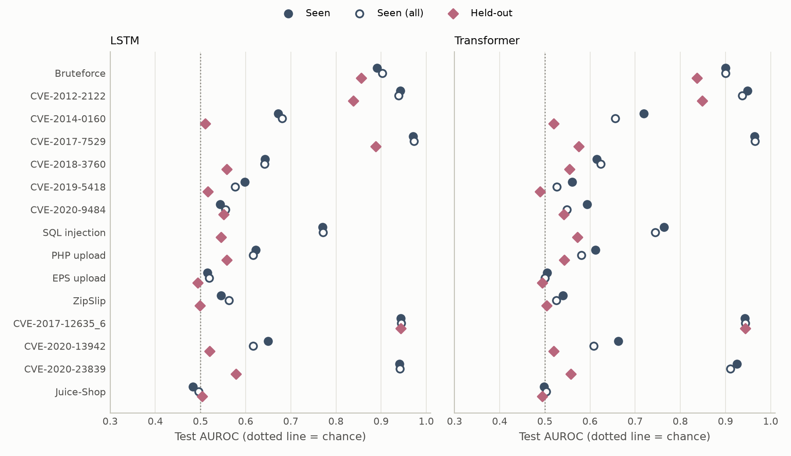
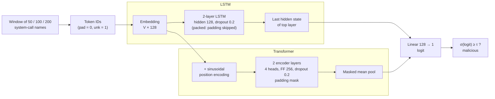
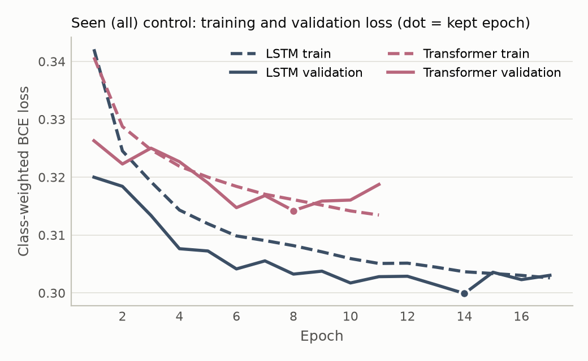
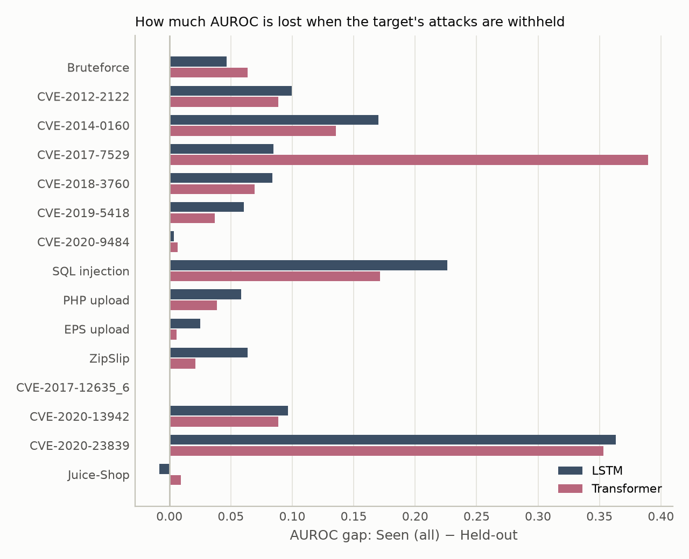
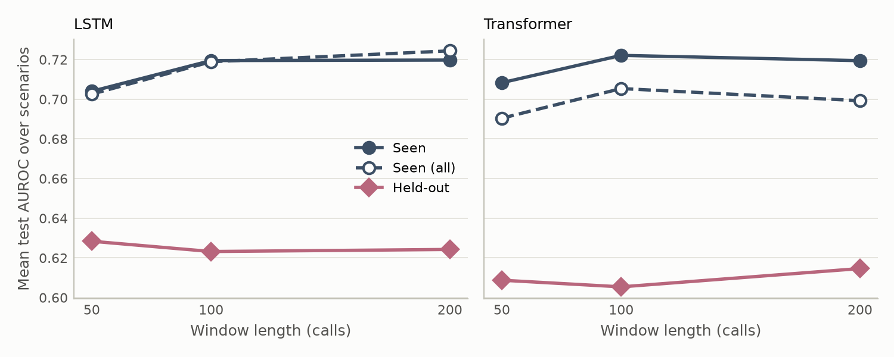
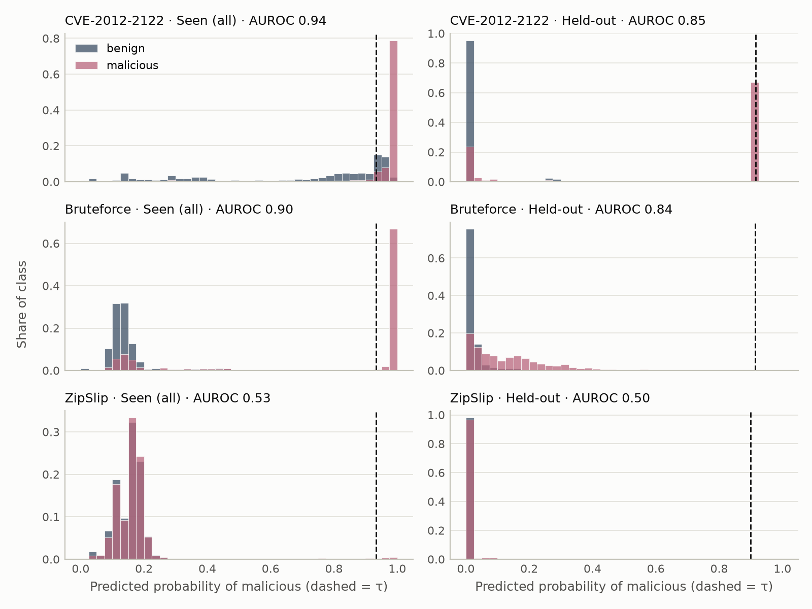

# Beyond Known Attacks: Can Deep Learning Models Detect Previously Unknown Cyberattacks?

CSC413 final project. Ryan H. Lin, Sebastian Sperneac, Arman Hovhannisyan,
Evan Tao (University of Toronto Mississauga).

Host-based intrusion detection systems watch the system calls a program makes.
Deep sequence models do well at telling benign from malicious call sequences,
but a high test score can mean two different things: the model learned what
malicious behaviour looks like in general, or it learned what *these particular
attacks* look like. Only the first helps against a vulnerability nobody has seen
yet.

We separate the two on [LID-DS-2021](https://github.com/LID-DS/LID-DS), a Linux
system-call dataset with 15 attack scenarios. We train an LSTM and a
Transformer encoder to classify windows of 50, 100, or 200 system-call names as
benign or malicious, and test each of the 15 scenarios as a target under three
conditions:

| Condition    | Training data | Target's attacks in training? | Threshold τ chosen on |
|--------------|---------------|-------------------------------|-----------------------|
| **Seen**       | target scenario only | yes | target's validation recordings |
| **Seen (all)** | all 15 scenarios | yes | validation recordings of all 15 |
| **Held-out**   | other 14 scenarios + target's benign recordings | **no** | validation recordings of the other 14 |

All three conditions are tested on exactly the same windows of the target
scenario, so the drop from Seen to Held-out measures how much of the detection
depends on having seen that attack. Seen (all) is the cleanest comparison: it
uses the same pool of training data as Held-out, plus the target's attacks.

## Main findings

1. **Withholding an attack costs most of the detection.** Averaged over the 15
   targets, AUROC falls from about 0.70–0.72 (Seen, Seen (all)) to about
   0.60–0.62 (Held-out). Compared with Seen (all), it is lower for 14 of 15
   targets with the LSTM and all 15 with the Transformer (sign test p ≤ 0.001).
   At the validation-chosen threshold the collapse is larger: mean F1 falls
   from 0.33–0.40 to under 0.08, and in 8 (LSTM) and 7 (Transformer) of the
   held-out targets the model flags no attack windows at all.
2. **Seen and Seen (all) score almost the same**, so the gap comes from access to
   the target's own attacks, not from training on one scenario versus all 15.
3. **Transfer happens, but only for a few attacks.** Held-out AUROC stays high
   for the password brute force (0.84–0.86), the MySQL authentication bypass
   (0.84–0.85) and CouchDB (0.94), and for the nginx overflow with the LSTM
   (0.89). For every other target it is within 0.08 of chance (0.5).
4. **The LSTM and Transformer generalize about equally.** Neither is
   consistently better in the Seen or Held-out conditions; the LSTM is slightly
   better in Seen (all) (14 of 15 targets, mean AUROC +0.018).
5. **More context does not help with unseen attacks.** Held-out AUROC is flat
   across 50-, 100- and 200-call windows (0.60–0.63).



## Contents

- [Data](#data)
- [Models](#models)
- [Training and hyperparameters](#training-and-hyperparameters)
- [Results](#results)
- [Examples of successful and unsuccessful predictions](#examples-of-successful-and-unsuccessful-predictions)
- [Interpretation](#interpretation)
- [Limitations](#limitations)
- [Ethical considerations](#ethical-considerations)
- [Repository layout and reproduction](#repository-layout-and-reproduction)
- [Authors](#authors)

Supplementary documentation: [docs/reproduction.md](docs/reproduction.md)
(data, pilot, full grid, analysis scripts) and [docs/gpu_setup.md](docs/gpu_setup.md)
(CUDA install, batch-size benchmark, troubleshooting). All tables are in
[results_summary/results.md](results_summary/results.md) (and as CSV next to it);
all figures are in [figures/](figures/).

## Data

LID-DS-2021 runs a vulnerable service in a Docker container, simulates normal
users, and in attack recordings adds an attacker that exploits a documented
vulnerability. Each recording has a system-call trace and JSON metadata with the
exploit timestamps.

| Scenario | Vulnerable software | Attack | Steps |
|---|---|---|---|
| Bruteforce_CWE-307 | Web app login | Password brute force | single |
| CVE-2012-2122 | MySQL | Authentication bypass | single |
| CVE-2014-0160 | OpenSSL (Heartbleed) | Memory over-read | single |
| CVE-2017-7529 | nginx | Integer overflow / data leak | single |
| CVE-2018-3760 | Sprockets (Rails) | Path traversal | single |
| CVE-2019-5418 | Ruby on Rails | File content disclosure | single |
| CVE-2020-9484 | Apache Tomcat | Deserialisation → RCE | single |
| CWE-89-SQL-injection | DVWA | SQL injection | single |
| PHP_CWE-434 | DVWA | Malicious file upload | single |
| EPS_CWE-434 | EPS-to-SVG converter | Malicious file upload → RCE | single |
| ZipSlip | Java unzip service | Archive path traversal | single |
| CVE-2017-12635_6 | CouchDB | Privilege escalation → RCE | multi |
| CVE-2020-13942 | Apache Unomi | Expression injection → RCE | multi |
| CVE-2020-23839 | GetSimple CMS | XSS → RCE | multi |
| Juice-Shop | OWASP Juice Shop | Multiple web vulnerabilities | multi |

**Splits.** The official partitions put every attack recording in the test set,
so we re-split the official test recordings 70/15/15 at the *recording* level,
stratified by scenario and exploit flag (seed 413), and merge them with the
official benign training and validation recordings. No recording is ever in two
splits.

**Windows and labels.** We keep only system-call entry events (one token per
call, names only, no arguments) after each recording's warm-up, split each
recording into per-thread streams, and cut the streams into non-overlapping
windows whose length is drawn from {50, 100, 200} with a fixed seed. Short final
windows are kept and padding is masked. A window is malicious if it contains a
call at or after the first non-reconnaissance exploitation timestamp (only
CVE-2017-12635_6's port scan counts as reconnaissance).

**Window caps.** The full dataset has about 35.9M windows (4.3B calls). After
the recording-level split we keep a uniform random sample of at most 100k
training and 50k validation and test windows per scenario, with a seed that
depends only on the global seed, scenario and split. This bounds compute, keeps
large scenarios (CVE-2017-12635_6 alone has 11.3M windows) from dominating the
pooled training set, keeps validation and test at their natural class ratio, and
makes each target's test windows identical in every condition.

**Dataset statistics** (per scenario, from the single-scenario splits; recordings
in brackets contain an attack):

| Scenario | Train recs | Val recs | Test recs | Train windows | Test windows | % malicious (train / test) |
|---|---|---|---|---|---|---|
| Bruteforce_CWE-307 | 845 (97) | 196 (21) | 136 (21) | 63,057 | 9,132 | 11.1 / 15.0 |
| CVE-2012-2122 | 828 (84) | 192 (18) | 132 (18) | 100,000 | 36,188 | 72.0 / 73.4 |
| CVE-2014-0160 | 824 (84) | 192 (18) | 132 (18) | 14,932 | 2,433 | 4.5 / 7.2 |
| CVE-2017-7529 | 803 (83) | 180 (18) | 127 (18) | 8,597 | 1,462 | 15.5 / 22.4 |
| CVE-2018-3760 | 812 (86) | 189 (18) | 128 (18) | 100,000 | 50,000 | 1.8 / 2.1 |
| CVE-2019-5418 | 826 (84) | 192 (18) | 132 (18) | 100,000 | 50,000 | 2.5 / 3.0 |
| CVE-2020-9484 | 825 (84) | 192 (18) | 132 (18) | 100,000 | 50,000 | 3.5 / 4.5 |
| CWE-89-SQL-injection | 826 (84) | 192 (18) | 132 (18) | 100,000 | 50,000 | 9.7 / 12.9 |
| PHP_CWE-434 | 824 (82) | 191 (18) | 132 (18) | 100,000 | 50,000 | 2.7 / 3.9 |
| EPS_CWE-434 | 826 (85) | 192 (18) | 132 (18) | 100,000 | 50,000 | 1.5 / 2.1 |
| ZipSlip | 824 (82) | 191 (18) | 132 (18) | 100,000 | 50,000 | 2.5 / 3.9 |
| CVE-2017-12635_6 | 818 (83) | 189 (18) | 131 (18) | 100,000 | 50,000 | 33.5 / 43.9 |
| CVE-2020-13942 | 822 (82) | 192 (18) | 131 (18) | 100,000 | 50,000 | 2.0 / 3.1 |
| CVE-2020-23839 | 826 (84) | 189 (18) | 132 (18) | 100,000 | 36,911 | 2.7 / 3.4 |
| Juice-Shop | 827 (85) | 192 (18) | 132 (18) | 100,000 | 50,000 | 3.6 / 4.8 |

Pooled over all 15 scenarios (the Seen (all) training set): 12,356 training
recordings (1,269 with attacks) and 1,286,586 training windows (11.4%
malicious), split almost evenly across the three window lengths; 609,456
validation windows (9.8% malicious). The vocabulary is built from training
windows only: 116–119 distinct calls for the pooled conditions and 15–84 for
single scenarios. Calls unseen in training are at most 0.0013% of any run's
test calls. Windows available
before capping and per-length counts are in
[results_summary/results.md](results_summary/results.md).

## Models

Both models read a padded window of call IDs and output one logit; P(malicious)
is its sigmoid. They have the same embedding size and almost the same number of
parameters, so differences come from recurrence versus attention.



**Parameter counts** (pooled vocabulary of V = 119 calls; computed by
`scripts/analyze_results.py` from the model classes):

| Module | LSTM | Transformer | Where the count comes from |
|---|---:|---:|---|
| Embedding | 15,232 | 15,232 | V × 128 |
| Sequence encoder | 264,192 | 264,960 | LSTM: 2 layers × 4 gates × (128 × (128 + 128) + 2 × 128 biases) = 2 × 132,096. Transformer: 2 layers × (attention in/out projections 66,048 + feed-forward 128→256→128 65,920 + two LayerNorms 512) = 2 × 132,480 |
| Output head | 129 | 129 | 128 weights + 1 bias |
| **Total** | **279,553** | **280,321** | single-scenario runs: 266k–275k (smaller vocabularies) |

## Training and hyperparameters

| Setting | Value |
|---|---|
| Loss | class-weighted binary cross-entropy (weights from the training class ratio) |
| Optimizer | Adam, batch size 256, no weight decay |
| Learning rate | LSTM 1e-3, Transformer 3e-4 (see below) |
| Epochs | at most 20; early stopping with patience 3 on validation loss; the weights from the best epoch are kept |
| Embedding / hidden size | 128 / 128 (LSTM), 128 / FF 256, 4 heads (Transformer) |
| Layers, dropout | 2, 0.2 |
| Threshold τ | the value maximizing F1 on the condition's allowed validation data (never the target's test data, and never the target at all for Held-out) |
| Hardware | one GTX 1660 Ti (6 GB), PyTorch 2.9.1 + CUDA 12.6; about 83 GPU-hours for the 90 runs |

**Hyperparameter tuning.** Architecture sizes were fixed in the proposal and not
tuned. The only tuned value is the Transformer's learning rate: at the shared
rate of 1e-3 its training loss stopped improving after the first epoch, so we
compared 1e-3, 3e-4 and 1e-4 on a reduced pooled sample (20k training and 10k
validation windows per scenario, 6 epochs) using **validation loss only**.
3e-4 gave the lowest validation loss (0.326, against 0.329 for 1e-4 and 0.332 for
1e-3); the LSTM at 1e-3 reached 0.321 on the same sample. No test data was used
for any choice. `training.lr_by_model` in [configs/default.yaml](configs/default.yaml)
records the override.

**Training curves.** Pooled runs reach their best validation loss between
epochs 4 and 17 and then flatten; only two of the 90 runs reached the 20-epoch
cap, and both had their best epoch at 17–18. The
Transformer's validation loss stays slightly above the LSTM's in every pooled
run.



Per-target curves: [Held-out](figures/loss_held_out.png) and
[Seen](figures/loss_seen.png).

## Results

Each Seen (all) model is trained once and evaluated on every target's test
windows (the training data does not depend on the target). The LSTM's Seen (all)
runs began before this reuse was added, and runs that resumed after an
interruption ended at slightly different weights (best validation loss
0.2999–0.3030), so three LSTM Seen (all) models exist; see
[docs/gpu_setup.md](docs/gpu_setup.md#troubleshooting).

### Overall (mean over the 15 target scenarios)

| Model | Condition | AUROC | AUPRC | F1 | Precision | Recall | FPR |
|---|---|---|---|---|---|---|---|
| LSTM | Seen | 0.715 | 0.395 | 0.399 | 0.477 | 0.414 | 0.084 |
| LSTM | Seen (all) | 0.716 | 0.400 | 0.366 | 0.856 | 0.317 | 0.019 |
| LSTM | Held-out | 0.624 | 0.263 | 0.076 | 0.413 | 0.068 | 0.002 |
| Transformer | Seen | 0.717 | 0.385 | 0.391 | 0.464 | 0.420 | 0.100 |
| Transformer | Seen (all) | 0.698 | 0.371 | 0.326 | 0.775 | 0.284 | 0.021 |
| Transformer | Held-out | 0.600 | 0.228 | 0.073 | 0.471 | 0.066 | 0.002 |

AUROC and AUPRC do not depend on the threshold and are the main comparison. F1,
precision, recall and FPR use τ chosen on validation data, so they also show
whether a threshold learned on known attacks still works on an unknown one.

### Test AUROC per target

| Target | LSTM Seen | LSTM Seen (all) | LSTM Held-out | Transformer Seen | Transformer Seen (all) | Transformer Held-out |
|---|---|---|---|---|---|---|
| Bruteforce_CWE-307 | 0.891 | 0.903 | 0.856 | 0.900 | 0.900 | 0.837 |
| CVE-2012-2122 | 0.943 | 0.938 | 0.839 | 0.949 | 0.937 | 0.849 |
| CVE-2014-0160 | 0.672 | 0.681 | 0.511 | 0.719 | 0.655 | 0.520 |
| CVE-2017-7529 | 0.971 | 0.973 | 0.888 | 0.965 | 0.965 | 0.575 |
| CVE-2018-3760 | 0.643 | 0.642 | 0.558 | 0.615 | 0.624 | 0.555 |
| CVE-2019-5418 | 0.598 | 0.577 | 0.516 | 0.561 | 0.527 | 0.490 |
| CVE-2020-9484 | 0.543 | 0.555 | 0.552 | 0.594 | 0.549 | 0.542 |
| CWE-89-SQL-injection | 0.770 | 0.772 | 0.545 | 0.764 | 0.744 | 0.572 |
| PHP_CWE-434 | 0.623 | 0.616 | 0.558 | 0.612 | 0.581 | 0.543 |
| EPS_CWE-434 | 0.515 | 0.519 | 0.494 | 0.505 | 0.500 | 0.494 |
| ZipSlip | 0.545 | 0.563 | 0.499 | 0.540 | 0.525 | 0.504 |
| CVE-2017-12635_6 | 0.944 | 0.944 | 0.944 | 0.943 | 0.944 | 0.944 |
| CVE-2020-13942 | 0.650 | 0.617 | 0.520 | 0.663 | 0.608 | 0.519 |
| CVE-2020-23839 | 0.940 | 0.942 | 0.579 | 0.925 | 0.911 | 0.558 |
| Juice-Shop | 0.483 | 0.496 | 0.504 | 0.498 | 0.503 | 0.494 |

AUPRC, F1 and FPR per target are in [results_summary/results.md](results_summary/results.md).

### Generalization gaps

Mean over targets of (first condition − second condition); "higher in" counts
targets where the first condition scores higher / lower; two-sided sign test.

| Model | Metric | Seen − Held-out | Seen (all) − Held-out | Seen − Seen (all) |
|---|---|---|---|---|
| LSTM | AUROC | +0.091 (13/2, p = 0.007) | +0.092 (14/1, p = 0.001) | −0.000 (5/10, p = 0.30) |
| LSTM | AUPRC | +0.132 (13/2, p = 0.007) | +0.137 (13/2, p = 0.007) | −0.006 (3/12, p = 0.04) |
| LSTM | F1 | +0.323 (15/0, p < 0.001) | +0.290 (14/0, p < 0.001) | +0.032 (12/3, p = 0.04) |
| Transformer | AUROC | +0.117 (14/1, p = 0.001) | +0.099 (15/0, p < 0.001) | +0.019 (10/5, p = 0.30) |
| Transformer | AUPRC | +0.157 (13/2, p = 0.007) | +0.143 (14/1, p = 0.001) | +0.014 (10/5, p = 0.30) |
| Transformer | F1 | +0.318 (15/0, p < 0.001) | +0.253 (13/0, p < 0.001) | +0.065 (15/0, p < 0.001) |



### Run-to-run variance

Each configuration was trained once, but the three LSTM Seen (all) models were
trained on identical data with identical settings, so evaluating all three on
every target shows how much results move between training runs
([results_summary/variance_lstm.md](results_summary/variance_lstm.md)). Each
model first reproduced its original runs' saved predictions exactly. Across
the 15 targets, AUROC differs between the three models by 0.009 on average and
by at most 0.022 (CVE-2014-0160); mean AUROC over targets is 0.713–0.718.
The Seen (all) − Held-out gap (mean 0.092) is about ten times the average
between-run spread, and is larger than it for 12 targets (only slightly for
EPS_CWE-434: 0.025 against 0.017). For
CVE-2020-9484, CVE-2017-12635_6 and Juice-Shop the gap (≤ 0.008) is within
run-to-run noise. Differences of about 0.02 or less, such as the LSTM's
Seen (all) lead over the Transformer (0.018) or Seen versus Seen (all), are of
the same size as this spread. The models differ only because some runs resumed
from a checkpoint, not by random seed, so true seed-to-seed variation is
probably larger.

### LSTM vs Transformer

Paired by target (Transformer − LSTM): Seen AUROC +0.001 (Transformer better on
6 of 15, p = 0.61); Seen (all) −0.018 (1 of 15, p = 0.001); Held-out −0.024
(6 of 15, p = 0.61). The architectures differ clearly only in the pooled seen
condition, where the LSTM is ahead.

### Window length



Longer windows help a little when the attack was seen (mean AUROC +0.01–0.02
from 50 to 100 calls) and not at all when it was held out.

### Errors at the chosen threshold

| Model | Condition | Pooled FPR | Pooled FNR | Targets with no detections |
|---|---|---|---|---|
| LSTM | Seen | 0.105 | 0.300 | 0 |
| LSTM | Seen (all) | 0.006 | 0.321 | 1 |
| LSTM | Held-out | 0.001 | 0.719 | 8 |
| Transformer | Seen | 0.125 | 0.290 | 0 |
| Transformer | Seen (all) | 0.007 | 0.332 | 2 |
| Transformer | Held-out | 0.002 | 0.719 | 7 |

Held-out errors are almost all false negatives: τ, tuned on the other
scenarios' attacks, sits around 0.89–0.95, and unseen attack windows rarely
score that high. The single-scenario Seen runs have the most false alarms,
mostly in Juice-Shop (FPR 0.54–0.70) and CVE-2019-5418 (0.28–0.44), where the
small validation sets give an unstable threshold.



The score histograms show both failure modes. For CVE-2012-2122 the held-out
model still separates the classes (AUROC 0.85) but many attack windows score
just under τ. For Bruteforce the attack windows move from near 1 to a broad
low range, so ranking survives (AUROC 0.84) but no threshold from other
scenarios catches them. For ZipSlip both classes collapse to the same low score.

## Examples of successful and unsuccessful predictions

[results_summary/examples.md](results_summary/examples.md) lists, for each
target, decoded test windows that were detected without the attack in
training, missed only when held out, missed in every condition, and false
alarms, with every model's probability for the same window. It also measures how
different benign and malicious test windows are as bags of calls (total
variation distance between their call-frequency distributions). Some examples
(`call×n` = n repeats):

- **Detected without training on the attack (CVE-2012-2122).** A 34-call
  MySQL window in which a connection thread sets socket options, exchanges a
  few reads and writes, then ends with `shutdown close madvise exit procexit`
  (twice) scored 0.978 with the held-out Transformer, above its τ of 0.916.
  `shutdown` and `procexit` are each 1.4% of this scenario's malicious calls
  and almost absent (0.0%) from its benign calls. The held-out LSTM missed the
  same window (0.039).
- **Missed only when held out (CVE-2017-7529).** A 100-call nginx window
  repeating `epoll_wait accept epoll_ctl epoll_wait recvfrom stat open fstat
  writev sendfile write×2 close×2` scored 1.000 with both Seen models and
  0.002–0.011 held out. Benign request handling uses the same calls, but at
  different rates (`stat` is 6.3% of malicious calls against 0.2% of benign
  calls), which the models only learn from this attack's own recordings.
- **Missed in every condition (CVE-2014-0160).** Heartbleed reads memory
  through ordinary TLS request handling. Its malicious windows have almost the
  same call mix as benign ones (TV distance 0.016; only Juice-Shop, at 0.007,
  is lower), so no condition detects them reliably: a 200-call malicious
  window scored 0.01–0.43 in every run.

## Interpretation

**Does the evidence support our hypothesis?** We expected the models to detect
held-out attacks much worse than seen ones, that is, to rely largely on the
specific attacks in their training data. The results support this. AUROC drops
for 14–15 of 15 targets when the target's attacks are withheld, and because Seen
and Seen (all) score the same, the drop is caused by the missing attack
examples rather than by a smaller or less diverse training set. Under a
realistic deployment, where the threshold must be set from known attacks, the
held-out models catch under 30% of malicious windows overall and none at all
for 7–8 targets.

The models are not purely memorizing, though. Held-out AUROC is clearly above
chance for 3–4 targets, and those are exactly the attacks whose malicious
windows differ most from benign activity by call mix: CVE-2017-12635_6 (TV
distance 0.886), Bruteforce (0.255), CVE-2017-7529 (0.248) and CVE-2012-2122
(0.172). Across all 15 targets, TV distance and held-out AUROC have a Spearman
rank correlation of 0.93 (LSTM) and 0.84 (Transformer). Where an attack looks
like normal activity at the level of call frequencies (TV distance below 0.11
for the other 11 targets), nothing transfers. This suggests that what carries
over to unseen attacks is mostly *which calls occur and how often*, not their
order, which a non-sequential baseline would test directly.

**Unexpected results.**

- **CVE-2017-12635_6 (CouchDB) scores 0.944 in every condition**, with nearly
  identical confusion counts. 91% of its malicious calls are `close` (against
  2.4% of benign calls): most malicious windows are nothing but repeated
  `close` calls (for example `close×100`), and every model, including the
  held-out ones, gives these a probability near 1. Every model also flags the
  same ~680 benign windows; the highest-scoring one is itself a pure `close`
  run (`close×200`), and the missed malicious windows we inspected mix `close`
  with other calls. We did not check why the held-out models also score pure `close`
  windows so highly; one possibility is that similar runs appear in other
  scenarios' attack windows.
- **Juice-Shop is at chance even when seen** (AUROC 0.48–0.50). Its malicious
  and benign windows have the most similar call mix of all targets (TV
  distance 0.007). The scenario has a single attack timestamp for a
  multi-stage attack, so a likely reason is that many windows labelled
  malicious are ordinary web-server activity after the first exploit step
  (label noise from the recording-level timing policy).
- **The Transformer held-out on CVE-2017-7529 scores 0.575 against the LSTM's
  0.888**, the largest model difference. It is a single run per model, so we do
  not read a general architecture effect into it.
- **Held-out τ is very high (0.89–0.95)** because pooled validation data
  contains strongly separable attacks; the F1-optimal threshold therefore sits
  above the scores of harder, unseen attacks. Threshold choice, not only
  ranking, is a major part of the generalization problem.

## Limitations

- **One run per configuration.** We have no repeated seeds. The three LSTM
  Seen (all) models differ by up to 0.022 AUROC on the same target, so
  differences of that size should not be over-interpreted, and this is likely
  a lower bound since those models are not independent seeds. Repeating the
  Held-out runs with several seeds would give proper error bars.
- **Window caps.** Each scenario contributes at most 100k training windows, so
  the models see a sample of the larger scenarios.
- **Label noise.** All calls after the first exploit timestamp in an attack
  recording are labelled malicious, including benign background activity in
  the same recording.
- **Call names only.** Arguments, return values and timing are discarded. Some
  attacks may only be visible in arguments (file paths, buffer contents).
- **Held-out keeps the target's benign recordings in training.** This tests
  transfer to an unknown attack on a *familiar* application, not on unfamiliar
  software.
- **Limited tuning.** Only the Transformer's learning rate was tuned, on a
  reduced sample.
- **One dataset.** LID-DS-2021 is recorded in a controlled container setup.
  Detecting a held-out scenario from this dataset says little about real
  zero-day attacks on production systems.

## Ethical considerations

The models can make mistakes in both directions. False positives could flag
legitimate activity and disrupt services if alerts triggered automatic
responses, and false negatives (which dominate for unseen attacks in our
results) leave attacks undetected. Model outputs should therefore only prompt
further investigation, never serve as evidence that an attack occurred.

Our results also show a risk of overconfidence: a detector with high accuracy on
known attacks can miss most unknown ones, so seen-attack benchmarks alone
overstate how well such systems protect against new vulnerabilities.

System-call recordings can contain sensitive data such as file paths,
process identifiers and request contents. We use only the public LID-DS-2021
dataset and only system-call names, and the repository contains no raw
recordings. Where our analysis describes why attacks go undetected, we report
aggregate behaviour (for example, call-frequency similarity) rather than
instructions for evading detection.

## Repository layout and reproduction

```
configs/default.yaml        all hyperparameters and paths
src/lidds_gen/
  data/                     torch-free pipeline
    recording.py            parse .zip recordings (.sc + .json), entry events after warm-up
    windows.py              per-thread, non-overlapping, variable-length windows + labels
    store.py                per-scenario .npz cache of windows
    splits.py               70/15/15 re-split of official test recordings; conditions
    vocab.py                vocabulary from training windows only, <pad>=0, <unk>=1
    experiment.py           assemble encoded train/val/test for one run, with window caps
    report.py               dataset summaries and recording manifests
  models/                   LSTMClassifier, TransformerClassifier (both return logits)
  training/                 dataset/collate, class-weighted BCE, early stopping, checkpoints
  evaluation/metrics.py     threshold selection (validation only), F1/AUROC/AUPRC/FPR, per length
scripts/
  prepare_data.py           raw dataset -> processed per-scenario caches
  run_experiment.py         one (model, condition, target) run
  run_all.py                full 2 x 3 x 15 grid (90 runs), resumable
  verify_results.py         identical test sets and no split leakage across all runs
  summarize_results.py      metric and gap CSVs
  analyze_results.py        tables in results_summary/ and figures in figures/
  export_examples.py        decoded example windows and call-frequency statistics
  variance_check.py         run-to-run variance from the distinct Seen (all) models
  summarize_data.py, configure_storage.py, extract_scenarios.py, benchmark_gpu.py
tests/                      unit tests on synthetic recordings (pytest)
docs/                       reproduction and GPU setup guides
results_summary/            result tables (Markdown + CSV) and prediction examples
figures/                    plots used in this README and the report
Proposal/                   LaTeX proposal (NeurIPS 2026 template)
```

Quick start (details in [docs/reproduction.md](docs/reproduction.md)):

```bash
python -m venv .venv
# Windows: .venv\Scripts\activate    macOS/Linux: source .venv/bin/activate
pip install -e ".[dev,analysis]"
pytest
python scripts/prepare_data.py                                  # needs LID-DS-2021 in data/raw
python scripts/run_all.py --include-seen-control                # 90 runs
python scripts/verify_results.py --results-root results
python scripts/analyze_results.py --results-root results
```

Any config value can be overridden with `--set dotted.key=value`. The dataset,
processed caches, results and checkpoints are git-ignored; only summarized
results are committed.

## Authors

**Ryan Lin.** Writing: Background and Past Literature, and Data (including the
scenario table); Limitations. Code: data pipeline: parsing LID-DS-2021
recordings, filtering entry events and warm-up calls, splitting recordings into
per-thread streams, the stratified 70/15/15 recording-level re-split, and
generating the 50/100/200-call windows and labels. Maintains the GitHub
repository and reviews pull requests for the data pipeline.

**Sebastian Sperneac.** Writing: Introduction, Modelling (including the model
figure), and Ethical Considerations; Results. Code: LSTM and Transformer
classifiers, the shared training loop with class-weighted BCE, and threshold (τ)
selection on validation data. Reviews pull requests for model and training code.

**Arman Hovhannisyan.** Writing: Abstract; Conclusion. Code: experiment runner
for the seen-attack and held-out-attack settings across all 15 scenarios and
three window lengths, including fixed seeds and logging of each run's
configuration.

**Evan Tao.** Writing: Discussion, and the dataset statistics table. Code:
evaluation scripts (metrics on test windows, seen vs. held-out performance gap
per scenario, proportion of malicious windows at each length), plus the result
tables and plots. Handles communication with the course staff.

The team meets weekly on Tuesdays at 9:00 PM over a video call to review
progress and assign tasks. All code is version-controlled on GitHub; each
component is developed on its own branch and merged after review by a second
team member.
